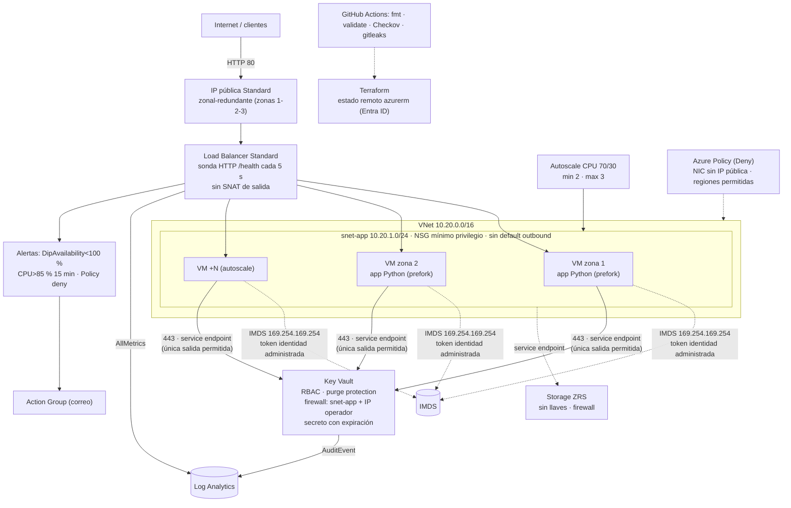

# CaribeShop — Plataforma segura, escalable y altamente disponible en Azure

Taller integrador · Infraestructura para TI · UTB
Terraform · GitHub Actions · Checkov · Locust · Azure (VMSS multi-zona, Load Balancer Standard, Key Vault, Azure Policy, Azure Monitor)

---

## 1. Arquitectura



| Decisión | Justificación |
|---|---|
| **Load Balancer Standard** (no App Gateway) | Cumple E2 a bajo costo (~18 USD/mes vs ~180+ USD de App Gateway WAF v2). Riesgo aceptado: sin TLS/WAF (ver tabla de riesgos). |
| **Sin salida a Internet** (subred sin *default outbound*, LB sin SNAT, NSG `Deny Internet`) | Una instancia comprometida no puede descargar herramientas ni exfiltrar a sitios arbitrarios (P3.2). Única salida: `AzureKeyVault:443`. |
| **App solo con librería estándar de Python** | Sin Internet no hay `pip install`; además cero dependencias = superficie mínima y arranque en segundos. |
| **Prefork (1 proceso por vCPU)** | Por el GIL, un proceso nunca pasa del 50 % de CPU en una B2ps_v2 y el autoscale (70 %) no se dispararía. Con carga se aprovechan las 2 vCPU. |
| **HTTP/1.1 keep-alive (máx. 50 peticiones por conexión) y cola de conexiones de 1024** | Evita reintentos de handshake TCP (+1 s) y mantiene la redistribución del LB tras un scale-out o una reparación; con `/health` en 503 la app cierra las conexiones vivas para que los clientes pasen a instancias sanas. |
| **Standard_B2ps_v2 (Arm64) en centralus** | Restricciones de la suscripción Azure for Students: 5 regiones permitidas, y el único tamaño serie B con zonas disponible es Arm64. La app no tiene dependencias nativas, así que corre igual. |
| **Rol con alcance al secreto** (no al vault) | S4 más estricto: la identidad del VMSS solo puede `get` sobre `db-password`. |
| **Secreto generado por Terraform** (`random_password`) | El valor nunca existe en Git ni en variables; solo en el estado remoto cifrado y en Key Vault. |
| **Rolling upgrade + `health_probe_id`** | Requisito de Azure para reparación automática basada en la sonda del LB (E4) y cambios sin caída. |
| **Histéresis 70 % / 30 %, cooldown 5 / 10 min** | Ver comentario en `infra/compute.tf` y `docs/INFORME-SOPORTE.md` §3. |

## 2. Estructura del repositorio

```
.
├── .github/workflows/ci.yml        # D1: fmt -check, validate, Checkov bloqueante, gitleaks, tests de la app
├── .gitignore                      # S1: estado, tfvars, backend.hcl, llaves
├── app/
│   ├── app.py                      # D3/S3: /, /health, /secret-check, /simulate-failure, /work
│   └── test_app.py                 # pruebas unitarias (verifican que el secreto nunca se filtra)
├── infra/                          # Terraform (un archivo por dominio)
│   ├── backend.tf                  # S1: backend azurerm (config parcial)
│   ├── backend.hcl.example
│   ├── providers.tf  variables.tf  main.tf  outputs.tf
│   ├── network.tf                  # S2, E2: VNet, snet-app, NSG, IP pública, LB, sonda
│   ├── security.tf                 # S3, S4: Key Vault, secreto, RBAC, Storage
│   ├── compute.tf                  # E1, E3, E4, D3: VMSS, autoscale, reparación
│   ├── monitoring.tf               # S6, E5: Log Analytics, diagnostic settings, alertas
│   ├── policy.tf                   # S5: políticas Deny
│   ├── templates/cloud-init.yaml.tftpl
│   ├── terraform.tfvars.example
│   └── bootstrap/bootstrap-backend.sh
├── loadtest/locustfile.py          # perfiles step (28 min), capacity, moderate
├── scripts/                        # P1, P2, P3 automatizados + monitor + gráficas
├── docs/
│   ├── GUIA-PRUEBAS.md             # Fase 4: comandos exactos P1/P2/P3 y KQL
│   ├── INFORME-SOPORTE.md          # Fase 5: trazabilidad, SLA, riesgos, costos, respuestas, guion
│   └── PR-DEMO.md                  # cómo crear el PR que falla por seguridad y su corrección
└── evidencias/                     # CSV/HTML de Locust, gráficos, salidas de az/KQL
```

## 3. Requisitos previos

| Herramienta | Versión probada |
|---|---|
| Terraform | ≥ 1.6 (CI 1.9.8) · provider azurerm 4.x (lock: 4.81.0) |
| Azure CLI | ≥ 2.60 (`az login`) |
| Python | 3.10+ con `pip install -r loadtest/requirements.txt` (Locust, matplotlib) |
| Bash | Git Bash, WSL o Azure Cloud Shell para `scripts/*.sh` |

Permisos: **Owner** (o Contributor + User Access Administrator) sobre la suscripción, porque Terraform crea asignaciones de rol y de política.

## 4. Despliegue

```bash
# 0) Verificar región con zonas y cuota de vCPU (B2ps_v2 x autoscale_max <= cuota)
./scripts/00-preflight.sh centralus Standard_B2ps_v2

# 1) Backend remoto (una sola vez): crea la cuenta de estado y escribe infra/backend.hcl
./infra/bootstrap/bootstrap-backend.sh centralus

# 2) Variables (archivo ignorado por Git)
cp infra/terraform.tfvars.example infra/terraform.tfvars   # editar operator_ip y alert_email

# 3) Desplegar
cd infra
terraform init -backend-config=backend.hcl
terraform plan -out tfplan
terraform apply tfplan          # ~8-12 min

# 4) Probar
curl "$(terraform output -raw app_url)/?json"
curl "$(terraform output -raw app_url)/secret-check"
```

> El correo de `alert_email` recibe un mensaje de Azure Monitor para confirmar la suscripción al Action Group.

## 5. Destrucción (¡obligatoria al terminar!)

```bash
cd infra
terraform destroy
# Key Vault queda en soft-delete 7 días (purge protection impide purgarlo): es lo esperado.
# Verificar en el portal que el RG rg-caribeshop-prod ya no existe:
az group exists -n rg-caribeshop-prod
# Al final del semestre, borrar también el estado:
az group delete -n rg-caribeshop-tfstate --yes
```

## 6. Variables

| Variable | Obligatoria | Default | Descripción |
|---|---|---|---|
| `operator_ip` | **sí** | — | IP pública del operador: firewall de Key Vault/Storage y única IP que puede llamar `/simulate-failure` |
| `alert_email` | **sí** | — | Correo del Action Group y de notificaciones de autoscale |
| `location` | no | `centralus` | Región **con zonas** y permitida por la política de la suscripción (centralus, brazilsouth, canadacentral, northcentralus, westus3) |
| `vm_size` | no | `Standard_B2ps_v2` | 2 vCPU Arm64 (único tamaño B zonal habilitado en Azure for Students) |
| `image_sku` | no | `server-arm64` | Ubuntu 24.04 Arm64 (`server` para x86) |
| `trusted_launch_enabled` | no | `false` | Secure Boot + vTPM |
| `zones` | no | `["1","2"]` | ≥ 2 zonas (validado) |
| `autoscale_min` / `default` / `max` | no | `2` / `2` / `3` | max × vCPU ≤ cuota regional |
| `cpu_scale_out_threshold` / `cpu_scale_in_threshold` | no | `70` / `30` | Histéresis |
| `scale_out_cooldown` / `scale_in_cooldown` | no | `PT5M` / `PT10M` | Cooldowns |
| `secret_expiration_days` | no | `90` | Expiración del secreto |
| `subscription_id` | no | `null` | Si no, usa `ARM_SUBSCRIPTION_ID` / sesión de `az` |

## 7. Checklist de la línea base de seguridad

- [x] **S1** Todo en Terraform; backend remoto `azurerm` con Entra ID (sin llaves); `.gitignore` excluye estado, `*.tfvars`, `backend.hcl`, llaves; gitleaks en CI revisa todo el historial.
- [x] **S2** VNet + `snet-app` con service endpoint `Microsoft.KeyVault`; NSG: entrada solo `Internet→80` y `AzureLoadBalancer`; salida solo `AzureKeyVault:443`; `Deny` explícito; ninguna VM con IP pública; 22/3389 cerrados.
- [x] **S3** Key Vault con RBAC, `purge_protection_enabled = true`, firewall `Deny` (snet-app + IP operador), secreto con `expiration_date`; la app lee vía IMDS y muestra solo longitud + SHA-256 truncado.
- [x] **S4** `Key Vault Secrets User` solo al `principal_id` del VMSS, con alcance **al secreto**.
- [x] **S5** Dos `azurerm_resource_group_policy_assignment` con efecto Deny (NIC con IP pública, regiones permitidas).
- [x] **S6** `azurerm_monitor_diagnostic_setting` del Key Vault (`AuditEvent`) → Log Analytics (tabla `AZKVAuditLogs`).
- [x] **E1** VMSS en zonas 1 y 2, mínimo 2 instancias.
- [x] **E2** LB Standard + IP Standard zonal-redundante + sonda HTTP `/health`.
- [x] **E3** Autoscale 70 %/30 % con cooldowns 5/10 min; `ignore_changes = [instances]`.
- [x] **E4** `automatic_instance_repair` (grace 10 min, Replace) ligado a la sonda.
- [x] **E5** Alertas `DipAvailability < 100 %` y CPU sostenida → Action Group con correo.
- [x] **D1** `ci.yml` en cada PR: `fmt -check -recursive`, `validate`, `checkov -d .` sin soft-fail.
- [x] **D2** Cada `#checkov:skip` con justificación en línea (11 skips, tabla en `docs/INFORME-SOPORTE.md` §5).
- [x] **D3** cloud-init: escribe la app, el unit de systemd endurecido y la arranca; cero pasos manuales.

## 8. Pruebas y evidencias

Ver **[docs/GUIA-PRUEBAS.md](docs/GUIA-PRUEBAS.md)**. Resumen:

| Prueba | Script | Evidencia generada en `evidencias/` |
|---|---|---|
| P1.1 capacidad 1 instancia | `scripts/p1-capacidad.sh` | `p1-capacidad_*.csv`, `.html`, `.png` |
| P1.2/1.3 escalonada 28 min | `scripts/p1-escalonada.sh` | `p1-escalonada_*.csv`, `.html`, `.png` (RPS/p95/instancias alineados), historial autoscale |
| P2.1 falla lógica | `scripts/p2-falla-logica.sh` | monitor CSV, resumen con % de error, instancias reemplazadas |
| P2.2 falla abrupta | `scripts/p2-falla-abrupta.sh` | monitor CSV, tiempo de recuperación |
| P3 seguridad + S2/S4/S5/S6 | `scripts/p3-seguridad.sh` | IPs, NSG, roles, egress, RequestDisallowedByPolicy, KQL |

## 9. DevSecOps

- Proteger `main`: *Settings → Branches → Add rule* → *Require status checks*: `terraform fmt + validate`, `checkov (bloqueante)`, `app + locustfile (sintaxis)`, `gitleaks (historial completo)`.
- PR que falla a propósito y su corrección: **[docs/PR-DEMO.md](docs/PR-DEMO.md)**.
- Validación local equivalente al CI:
  ```bash
  terraform -chdir=infra fmt -check -recursive
  terraform -chdir=infra init -backend=false && terraform -chdir=infra validate
  checkov -d . --framework terraform github_actions secrets --compact --quiet --skip-path infra/.terraform
  python -m unittest discover -s app -v
  ```
